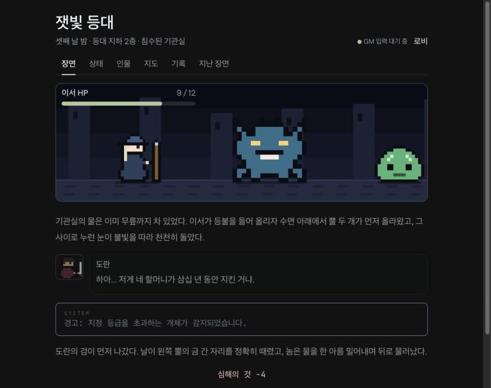
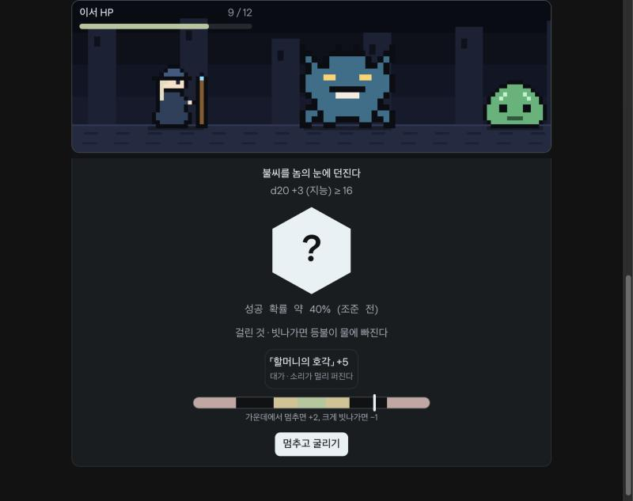
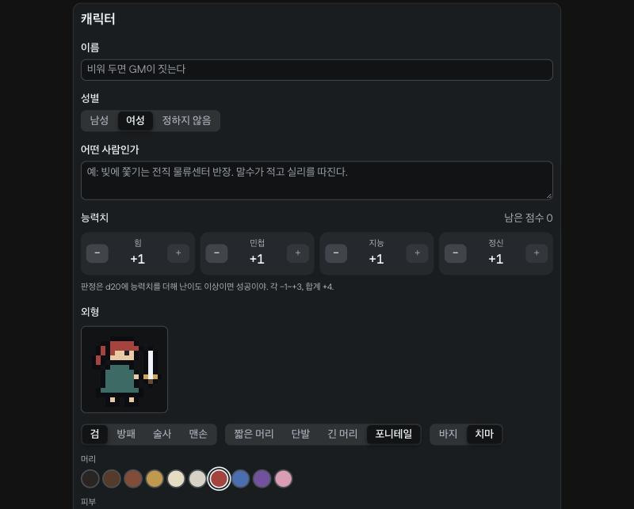
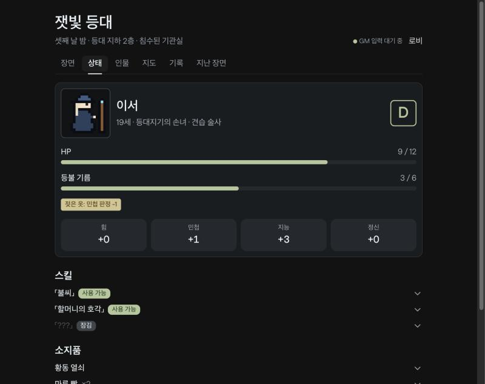
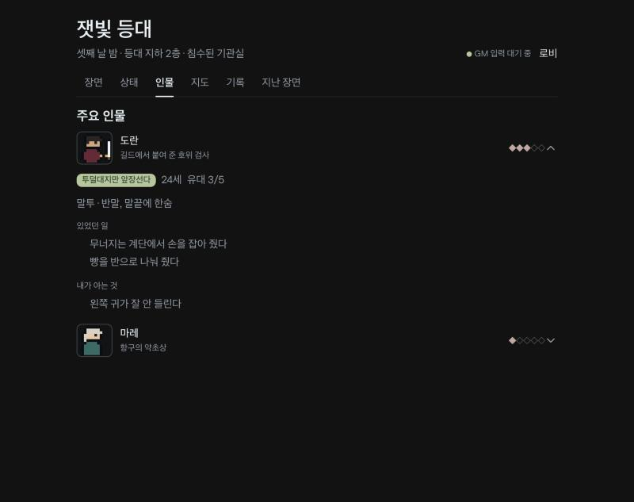
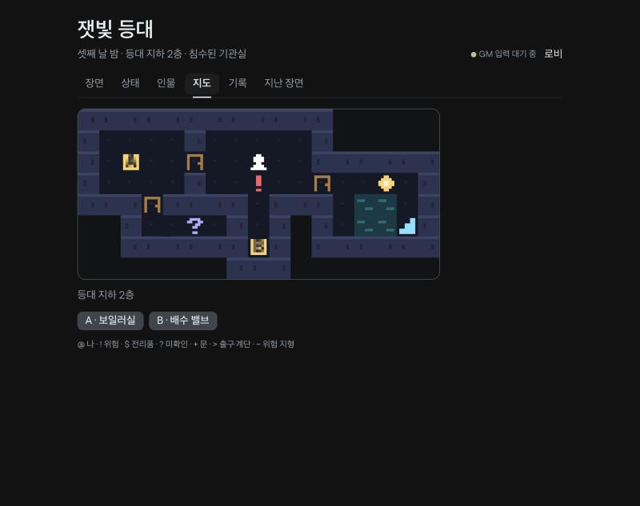

# 방구석 GM 🎲

Claude Code가 게임 마스터가 되는 도트 감성 텍스트 RPG. 방에서 혼자 `/rp` 한 줄이면 GM이 세계를 짓고, 판을 굴리고, 보스 도트까지 찍어 준다. 헌터물, 로판, 무협, 크툴루 호러, 던전 탐험, 전투 없는 현대 드라마까지 장르를 가리지 않는다.

이야기는 패널과 채팅 창 양쪽에 똑같이 나오고, 행동 입력과 주사위도 어느 쪽에서든 할 수 있다.



## 되는 것

| | |
|---|---|
|  | **주사위는 직접 굴린다.** 성공 확률이 보이고, 스킬을 얹거나 타이밍 게이지를 맞혀 확률을 끌어올린다. GM은 결과 숫자가 온 뒤에야 다음 장면을 쓴다. |
|  | **캐릭터 만들기.** 장르·분위기·난이도, 엔딩이 있는 이야기인지 끝없이 이어 갈지(엔드리스), 전투가 있는지 없는지(비전투), 내 캐릭터의 대사와 행동을 GM이 살려서 써 줄지(주인공 모드)를 고르고, 능력치를 나누고, 도트 캐릭터의 성별·머리 모양·색·무기를 정한다. 귀찮으면 "알아서 시작". |
|  | **상태창.** HP와 장르별 자원, 능력치, 스킬, 소지품. 스킬과 아이템은 "이번 행동에 쓰기"로 행동에 붙인다. |
|  | **인물.** 만난 사람마다 도트 프로필, 태도, 유대, 있었던 일, 내가 아는 것. |
|  | **지도.** 가 본 곳만 그려지는 도트 지도. 이름 있는 장소를 누르면 그리로 이동하는 행동이 입력된다. |

그 밖에:

- **도트 전투 화면**: 때리고 맞는 연출과 피해 숫자. 보스는 GM이 그 자리에서 전용 도트를 그린다.
- **입력 방식 여러 가지**: 자유 행동, 판정, 선택지, 제한 시간 선택, 암호 입력, 카드 뽑기.
- **카운트다운 시계, 전리품 카드, 승급 연출.**
- **엔딩**: "엔딩 있음"으로 시작한 캠페인은 결말 갈래가 여럿 있고, 내가 한 일에 따라 진 엔딩부터 배드 엔딩까지 갈린다. 끝나면 결말 화면과 그동안의 기록이 뜨고, 후일담이나 2회차로 이어 갈 수 있다. "엔드리스"로 시작하면 막이 바뀌며 계속 이어지고, 원할 때 "엔딩 내 줘"라고 하면 그때 닫는다.
- **지난 장면 탭**: 지나간 장면과 그때 내가 고른 것이 전부 남는다.
- **스포일러 방지 구조**: 패널은 GM이 장면을 올리는 순간의 상태만 본다. 수치가 본문보다 먼저 바뀌어 보이는 일이 없다.

## 설치: AI 에이전트에게 맡기기

Claude Code에 이 레포 주소를 주고 이렇게 말하면 된다.

```text
https://github.com/milmilkim/bangguseok-gm 이 레포 README의 "에이전트용 설치 절차"대로 설치해 줘.
```

### 에이전트용 설치 절차

이 절을 읽는 AI 에이전트는 아래를 순서대로 실행한다. 스킬이 `~/personal/rp` 경로를 그대로 쓰므로 레포 이름과 상관없이 **반드시 그 위치에** 받는다.

1. 필요한 것을 확인한다: `python3 --version` 이 3.9 이상, `node --version` 이 20 이상. 없으면 설치를 멈추고 유저에게 알린다.
2. 레포를 받는다. 이미 있으면 `git -C ~/personal/rp pull` 만 한다.
   ```bash
   git clone https://github.com/milmilkim/bangguseok-gm.git ~/personal/rp
   ```
3. 스킬을 Claude Code의 스킬 폴더에 복사한다.
   ```bash
   mkdir -p ~/.claude/skills/rp && cp ~/personal/rp/skill/SKILL.md ~/.claude/skills/rp/SKILL.md
   ```
4. 패널을 빌드하고 서버를 띄운다. 처음에는 `npm install` 과 빌드가 돌아서 1분쯤 걸린다.
   ```bash
   python3 ~/personal/rp/rp.py start
   ```
5. 확인한다. `패널: http://localhost:4173/` 이 출력되고 아래 명령이 `selfcheck ok` 를 내면 끝이다.
   ```bash
   python3 ~/personal/rp/rp.py selfcheck
   ```
6. 유저에게 "새 Claude Code 세션에서 `/rp` 를 입력하면 시작된다"고 알린다. 스킬은 세션을 시작할 때 읽히므로 설치한 세션에서는 바로 안 될 수 있다. 예제 캠페인을 가져올지도 물어본다(아래 "예제 캠페인").

## 플레이

1. Claude Code에서 `/rp` 를 입력한다. 패널(로비)이 열린다.
2. 로비에서 이어할 캠페인을 고르거나 새 게임을 만든다. 채팅에 "헌터물로 새 게임, 알아서 만들어 줘"라고 말해도 된다.
3. 장면은 눌러서(또는 Space) 한 문단씩 넘겨 읽는다. 다 읽으면 아래에 입력 칸이 열린다.
4. 하고 싶은 행동을 자유롭게 쓴다. 결과가 불확실하면 GM이 판정을 요구하고, 주사위를 굴리면 다음 장면이 온다.

알아 두면 좋은 것:

- **채팅 창에서도 똑같이 된다.** 본문이 채팅에도 나오고, 행동을 채팅에 써도 된다. 판정이 떴을 때 "굴려"라고 쓰면 GM이 대신 굴린다. 제한 시간과 타이밍 게이지만 패널 전용이다.
- **패널 없이 하기**: `/rp 패널 없이`. 창을 띄우지 않고 채팅에 꾸밈 없는 글로만 진행한다. 상태나 지도가 궁금하면 `http://localhost:4173/` 을 열어 보면 된다.
- **게임 밖 이야기**(규칙 질문, "전투 좀 늘려 줘" 같은 방향 조정)는 채팅에 그냥 말하면 된다. GM이 `(GM)` 으로 답하고 다음부터 반영한다.
- **저장**은 자동이다. "오늘은 여기까지"라고 하면 정리하고 끝낸다.
- 화면 오른쪽 위 표시: `GM 입력 대기 중`(내 차례) / `GM 쓰는 중` / `GM 자리 비움`(채팅에 아무 말이나 보내면 깨어난다).

## 업데이트

로비를 열면 이 레포에 새 버전이 있는지 확인한다. 있으면 "새 버전이 있어" 안내와 **업데이트** 버튼이 뜨고, 누르면 새 버전을 받아(`git pull`) 스킬을 다시 설치하고 패널과 서버를 새로 올린다. 진행 중인 캠페인과 세이브는 그대로다.

- 스킬(GM 규칙)은 **새 `/rp` 세션부터** 적용된다. 하던 세션은 예전 규칙으로 계속된다.
- 설치된 스킬을 직접 고쳐 쓰고 있었다면 덮어쓰기 전에 `~/.claude/skills/rp/SKILL.md.bak` 으로 남긴다.
- 레포 폴더에 커밋하지 않은 수정이 있어서 받을 수 없으면 그 이유를 화면에 보여 주고 아무것도 바꾸지 않는다.
- 터미널에서는 `python3 ~/personal/rp/rp.py update` 가 같은 일을 한다.

## 예제 캠페인

진행 중이던 캠페인 세 개가 예제로 들어 있다. 가져오면 로비의 "이어하기"에 나타나고, 그 시점에서 이어서 할 수 있다. 상태 파일이 어떻게 생겼는지 보는 용도로도 쓴다.

| 슬러그 | 제목 | 장르 |
|---|---|---|
| `cheongun-3jo` | 청운 용역 3조 | 헌터물 |
| `second-entrance` | 두 번째 입학식 | 로판 |
| `mukdo-ebb` | 묵도의 썰물 | 크툴루 호러 |

```bash
python3 ~/personal/rp/rp.py example cheongun-3jo
```

`examples/<슬러그>/save.md` 는 GM 전용 설계라 반전이 전부 적혀 있다. 그 캠페인을 직접 해 볼 거면 열지 않는다.

## 구조

- `skill/SKILL.md`: `/rp` 스킬 본문. GM 규칙, 문체, 진행 순서
- `rp.py`: 패널 서버, 장면 전송, 입력 대기, 주사위. `python3 rp.py` 로 사용법 출력
- `web/`: 패널 앱. Vite + React 19 + [Astryx](https://astryx.atmeta.com/) gothic 테마
- `examples/`: 예제 캠페인

내 캠페인은 아래 위치에 생기고 git에는 올라가지 않는다(`.gitignore`).

- `ui/state/<슬러그>.json`: 캠페인의 공개 상태
- `ui/log/<슬러그>.jsonl`: 지나간 장면과 그때 유저가 고른 것
- `ui/portraits/<슬러그>/<이름>.png`: 있으면 도트 프로필 대신 쓰는 초상
- `saves/<슬러그>.md`: 재개 지점과 GM 전용 내용. **스포일러이니 플레이어는 열지 않는다**

### 동작 방식

1. GM이 `rp.py turn <슬러그>` 로 장면 대본을 올린다. 직전 장면은 로그에 쌓이고, 이 명령은 백그라운드에서 패널 입력을 기다린다.
2. 유저가 패널에서 행동을 입력하거나 주사위를 굴리면 서버가 그 입력을 넘기고, 대기 명령이 끝나면서 GM이 다시 깨어난다. 채팅으로 입력하면 GM이 `rp.py answer` 로 같은 경로에 넣는다.
3. 패널은 `turn` 이나 `publish` 때 찍힌 상태 사본만 읽는다.

서버는 127.0.0.1 에만 열리고, 다른 사이트가 입력을 밀어 넣지 못하게 Host와 Origin을 확인한다.

### 제한

- 한 번에 한 세션만 플레이할 수 있다. 입력 대기가 서버 하나에 하나뿐이라 두 세션이 동시에 돌리면 서로의 대기를 밀어낸다.
- 패널을 Claude 앱 안에서 자동으로 여는 건 데스크톱 앱의 브라우저 창 기능을 쓴다. 터미널 CLI에서는 주소가 출력되니 브라우저로 직접 연다.
- 설치 경로가 `~/personal/rp` 로 고정이다.

## 고치기

스킬을 고치면 `skill/SKILL.md` 에도 복사해서 커밋한다(두 곳에 있다).

```bash
cp ~/.claude/skills/rp/SKILL.md ~/personal/rp/skill/SKILL.md
```

패널을 고치면 다시 빌드하고 패널을 새로 고친다. Astryx 컴포넌트 사용법은 `web/AGENTS.md` 와 `npx astryx component <이름>` 참고.

```bash
cd ~/personal/rp/web && npm run build
```

`rp.py` 를 고치면 자체 점검을 돌리고 서버를 다시 띄운다.

```bash
cd ~/personal/rp && python3 rp.py selfcheck && python3 rp.py stop && python3 rp.py start
```
